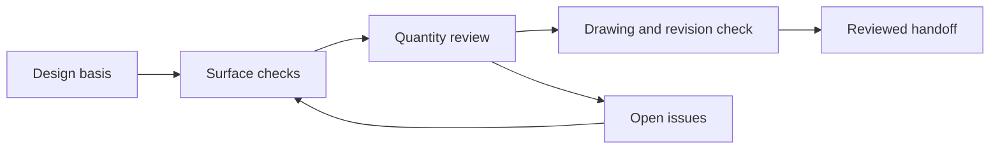

# Civil 3D Workflow Playbook

**Make a design handoff understandable, traceable and reviewable.**

This documentation project shows how to structure a small civil design exercise: define the basis,
check surface inputs, separate quantity methods, record decisions and assemble a clear handoff.

**Portfolio documentation demo · synthetic exercise · no proprietary drawings**

The workflow is a reference-informed learning playbook. It has not been executed inside Civil 3D
as part of this deliverable. No DWG, software certification, client project or production automation
is claimed. The [worked example](examples/DEMO-001-review.md) is a paper exercise.

## Start here

| Document | Use it to |
|---|---|
| [Design basis](docs/01-design-basis.md) | Establish units, datum, sources and criteria |
| [Surface review](docs/02-surface-review.md) | Check boundaries, breaklines and survey anomalies |
| [Quantity review](docs/03-quantity-review.md) | Reconcile a surface-volume method with section quantities |
| [Drawing handoff](docs/04-handoff.md) | Package an issue with a register and open-item log |
| [AI assistance boundary](docs/05-ai-use.md) | Decide where language-model assistance is useful |
| [Review checklist](templates/review-checklist.md) | Record evidence and unresolved questions |
| [Decision log](templates/decision-log.csv) | Capture a choice, its basis and reviewer status |

## A practical learning exercise

Use the synthetic station areas in the companion
[earthworks demo](https://github.com/TusharSrivastava751/earthworks-quantity-audit) to reproduce
500 m³ cut and 320 m³ fill. Explain why that arithmetic alone cannot validate a Civil 3D surface.
Then review the [sample open-item log](examples/DEMO-001-review.md) and identify the evidence
required before each item can close. Companion links work after those repositories are published.

## Sources and scope

[Autodesk's volume dashboard workflow](https://help.autodesk.com/cloudhelp/2022/ENU/Civil3D-UserGuide/files/GUID-F06475D1-BCB8-456A-AB29-E6B731DB32A8.htm)
describes comparing surfaces and reporting bounded volumes. The
[Autodesk grid-volume explanation](https://help.autodesk.com/cloudhelp/2022/ENU/Civil3D-UserGuide/files/GUID-62EC28FA-E636-4134-9153-4EE3328154A1.htm)
notes that grid volumes depend on sampling. Menu locations vary by release; these references are
Civil 3D 2022 documentation, not a verified click-by-click guide to every version.

This original documentation is AI-assisted. See [provenance](PROVENANCE.md) and [license](LICENSE).
No local design standard is adopted by this playbook, and no checklist replaces qualified review.
